# BikeStores Data Platform: Medallion Lakehouse on Azure

An end-to-end data engineering project that moves the **BikeStores** sales database from **SQL Server** into an **Azure Data Lake** and transforms it through **Bronze → Silver → Gold** layers using **Azure Databricks (PySpark + Delta Lake)**. The Gold layer feeds an interactive **sales dashboard**.

The project focuses on **data quality**: dirty records were deliberately injected into the source, and the Silver layer detects, isolates and logs them instead of silently dropping or passing them through.

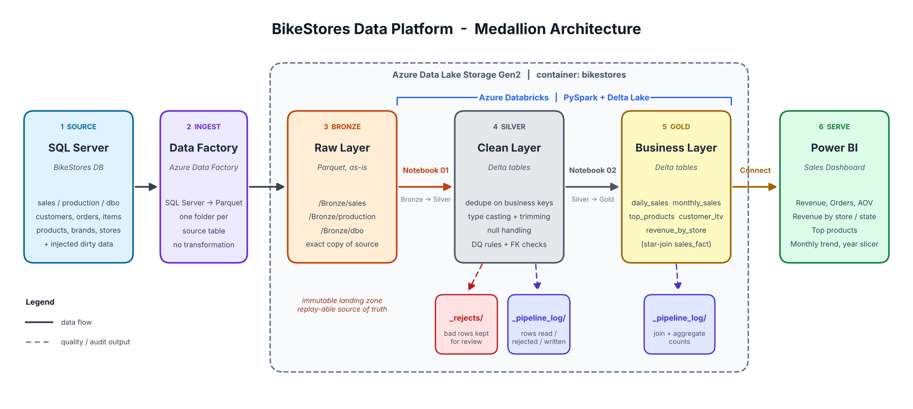

---

## Table of Contents

1. [Project Highlights](#project-highlights)
2. [Architecture](#architecture)
3. [Tech Stack](#tech-stack)
4. [Source Data](#source-data)
5. [Layer-by-Layer Walkthrough](#layer-by-layer-walkthrough)
   - [Bronze: raw landing zone](#-bronze--raw-landing-zone)
   - [Silver: cleaned and validated](#-silver--cleaned-and-validated)
   - [Gold: business-ready aggregates](#-gold--business-ready-aggregates)
6. [Data Quality Proof](#data-quality-proof)
7. [Pipeline Results](#pipeline-results)
8. [Analytics Queries](#analytics-queries)
9. [Dashboard](#dashboard)
10. [Repository Structure](#repository-structure)
11. [How to Run](#how-to-run)
12. [Design Decisions](#design-decisions)
13. [Known Limitations and Future Improvements](#known-limitations-and-future-improvements)

---

## Project Highlights

- **Medallion architecture** (Bronze / Silver / Gold) on Azure Data Lake Storage Gen2.
- **Delta Lake** tables in Silver and Gold, so writes are ACID and tables can be queried from SQL.
- **Rule-based data quality checks** with a dedicated `_rejects/` folder for every table, so bad rows are quarantined and not lost.
- **Referential integrity enforced in the lake**: orders must have a valid customer, order items must belong to a valid order (`left_semi` / `left_anti` joins).
- **Built-in auditability**: every step writes `rows_read / rows_rejected / rows_written` to a `_pipeline_log` Delta table, in both Silver and Gold.
- **Business-ready Gold tables** that power a dashboard with KPIs, store, state, product and trend views.

---

## Architecture

| # | Stage | What happens |
|---|-------|--------------|
| 1 | **Source** | SQL Server `BikeStores` database (`sales`, `production`, `dbo` schemas), with dirty data inserted for testing. |
| 2 | **Ingest** | **Azure Data Factory** copies the source tables from SQL Server into the lake as **Parquet**, one folder per table, with no transformation. |
| 3 | **Bronze** | Raw, as-is copy of the source in ADLS Gen2 (`/Bronze/<schema>/<table>`). |
| 4 | **Silver** | Notebook `01` deduplicates, standardises types and text, handles nulls, validates rows, quarantines rejects. Output is Delta. |
| 5 | **Gold** | Notebook `02` joins Silver tables into a sales fact and builds business aggregates. Output is Delta. |
| 6 | **Serve** | A **Power BI** dashboard reads the Gold layer. |

---

## Tech Stack

| Area | Technology |
|------|-----------|
| Source database | Microsoft SQL Server (SSMS) |
| Ingestion | Azure Data Factory (SQL Server to ADLS Gen2, Parquet output) |
| Storage | Azure Data Lake Storage Gen2 (`abfss://`), container `bikestores` |
| Processing | Azure Databricks, PySpark |
| Table format | Parquet (Bronze), Delta Lake (Silver and Gold) |
| Visualisation | Power BI (dashboard built on the Gold layer) |
| Language | Python / PySpark, SQL |

---

## Source Data

The source is the classic **BikeStores** sample database. Row counts at extraction time:

| Schema | Table | Rows | Used in pipeline |
|--------|-------|-----:|:----------------:|
| sales | customers | 1,445 | Yes |
| sales | orders | 1,618 | Yes |
| sales | order_items | 4,722 | Yes |
| sales | stores | 3 | Yes |
| production | products | 320 | Yes |
| production | brands | 11 | Yes |
| production | categories | 16 | Yes |
| production | stocks | 938 | Not in this version |
| sales | ca_customers_backup | 284 | No (backup table) |
| sales | orders_archive | n/a | No (archive table) |
| production | product_reviews, sales.loyalty_programs, dbo.Categories | 0 | No (empty) |

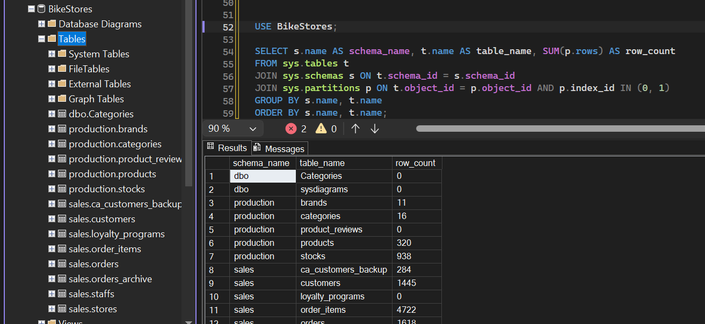

---

## Layer-by-Layer Walkthrough

### 🥉 Bronze: raw landing zone

- Stores an **exact copy** of the source tables as Parquet.
- Organised by source schema: `Bronze/sales`, `Bronze/production`, `Bronze/dbo`.
- Never modified. It is the replayable source of truth, so Silver and Gold can always be rebuilt from it.

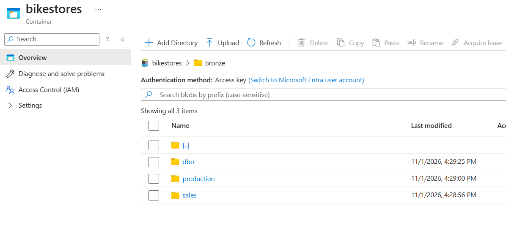

### 🥈 Silver: cleaned and validated

Implemented in [`notebooks/01_bronze_to_silver.ipynb`](notebooks/01_bronze_to_silver.ipynb). Every table follows the same six steps: **read → deduplicate → standardise → handle nulls → validate → write (valid + rejects) → log**.

| Table | Deduplicate on | Standardisation | Null handling | Validation rules (row is rejected if it fails) |
|-------|---------------|-----------------|---------------|-----------------------------------------------|
| `customers` | `customer_id` | Cast id to int; trim + `initcap` names; trim + lowercase email; trim street, city, zip; trim + uppercase state | `phone` → `"unknown"` | `customer_id` not null; `email` contains `@` |
| `orders` | `order_id` | Cast ids and status to int; cast dates with `to_date` | `shipped_date` stays `NULL` (order not shipped yet is valid) | ids and `order_date` not null; `order_date` not in the future; `shipped_date` is null or ≥ `order_date`; **customer must exist in Silver `customers`** |
| `order_items` | `order_id` + `item_id` | Cast ids and quantity to int; `list_price` → `decimal(10,2)`; `discount` → `decimal(4,2)` | `discount` → `0` | `order_id` and `product_id` not null; `quantity > 0`; `list_price >= 0`; `discount` between 0 and 1; **order must exist in Silver `orders`** |
| `products` | `product_id` | Trim all string columns | n/a | `product_id` not null; `list_price >= 0` |
| `categories` | `category_id` | Trim all string columns | n/a | `category_id` not null |
| `brands` | `brand_id` | Trim all string columns | n/a | `brand_id` not null |
| `stores` | `store_id` | Trim all string columns | n/a | `store_id` not null |

**Processing order matters.** `customers` is written first, then `orders` (which checks against Silver customers), then `order_items` (which checks against Silver orders). This guarantees no orphan records reach Gold.

Output layout:

```
Silver/
├── customers/  orders/  order_items/
├── products/   categories/  brands/  stores/
├── _rejects/          <- quarantined rows, one sub-folder per table
└── _pipeline_log/     <- rows read / rejected / written per step
```

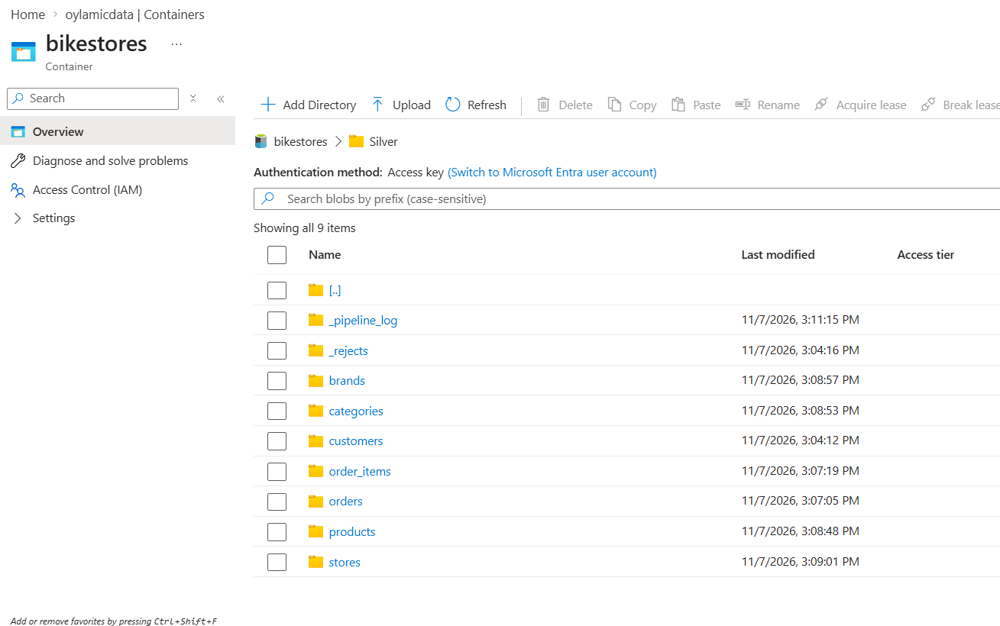

### 🥇 Gold: business-ready aggregates

Implemented in [`notebooks/02_silver_to_gold.ipynb`](notebooks/02_silver_to_gold.ipynb).

**Step 1: build the `sales` fact (in memory).** Silver `order_items` is joined to the other Silver tables:

```
order_items ⟶ orders (excluding status 3) ⟶ products ⟶ brands ⟶ categories ⟶ customers ⟶ stores
```

- Orders with `order_status = 3` (**Rejected**) are excluded from revenue.
- Revenue is calculated per line as:

```
revenue = quantity × list_price × (1 − discount)
```

**Step 2: aggregate into five Gold tables.**

| Gold table | Grain | Key measures | Rows |
|-----------|-------|--------------|-----:|
| `daily_sales` | one row per `order_date` | `total_revenue`, `total_orders`, `units_sold` | 711 |
| `monthly_sales` | `year` + `month` | `total_revenue`, `total_orders`, `units_sold` | 29 |
| `top_products` | `year` + product (with brand and category) | `total_revenue`, `units_sold` | 432 † |
| `customer_ltv` | `year` + customer (with state) | `lifetime_value`, `total_orders` | 1,557 † |
| `revenue_by_store` | `year` + store (with store state) | `total_revenue`, `total_orders` | 9 † |

† These three tables were rebuilt with an extra **`year`** column (final Gold cell, written with `overwriteSchema`) so the dashboard's Year slicer works. Before that step they had 304, 1,445 and 3 rows. With `year` in the grain each product, customer and store gets one row per year (3 stores × 3 years = 9).

**Cross-check:** after the rebuild, the notebook sums revenue across the three tables and gets the same total each time (≈ **7,426,009**, matching the dashboard's 7.43M). The cents-level differences (`.06`, `.87`, `.05`) come from rounding at each group level.

The Gold tables are also registered in the metastore as external Delta tables under a `gold` database (`gold.daily_sales`, `gold.monthly_sales`, ...), so they can be queried with plain SQL.

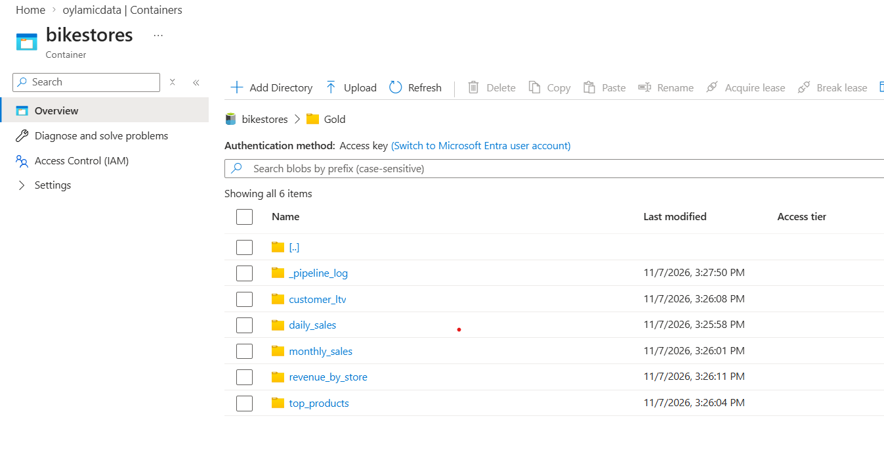

---

## Data Quality Proof

To prove the checks work, dirty rows were inserted into the source. For example, order `1616` contains three problem line items:

| order_id | item_id | product_id | quantity | list_price | discount | Problem |
|---------:|--------:|-----------:|---------:|-----------:|---------:|---------|
| 1616 | 1 | 1 | **-5** | 500.00 | 0.10 | Negative quantity |
| 1616 | 2 | 2 | 2 | **0.00** | 0.10 | Zero price (passes the `>= 0` rule, see [limitations](#known-limitations-and-future-improvements)) |
| 1616 | 3 | 3 | 1 | 400.00 | **1.50** | Discount above 100% |

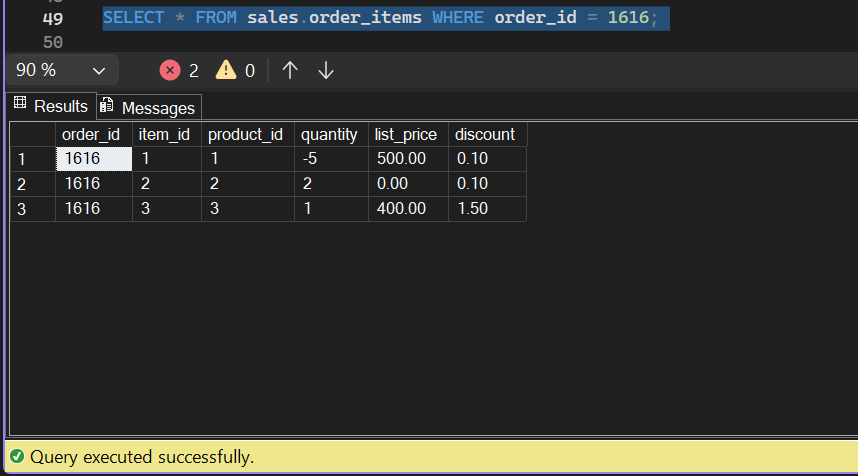

Result in Silver: the negative-quantity and invalid-discount rows are written to `Silver/_rejects/order_items` and never reach Gold. Querying Silver for order `1616` afterwards returns **only item 2** (the zero-price row), confirming the other two were rejected.

Silver notebook output:

| Table | Step | Read | Rejected | Written |
|-------|------|-----:|---------:|--------:|
| customers | duplicates removed | 1,445 | 0 | 1,445 |
| customers | validate + write | 1,445 | 0 | 1,445 |
| orders | duplicates removed | 1,618 | 0 | 1,618 |
| orders | validate + write | 1,618 | **2** | 1,616 |
| order_items | duplicates removed | 4,722 | 0 | 4,722 |
| order_items | validate + write | 4,722 | **2** | 4,720 |

<table>
  <tr>
    <td>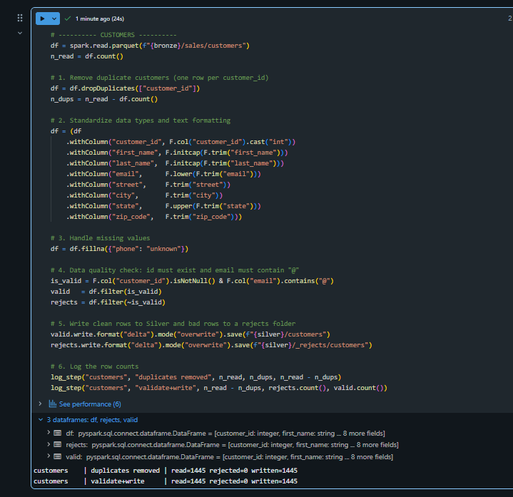</td>
    <td>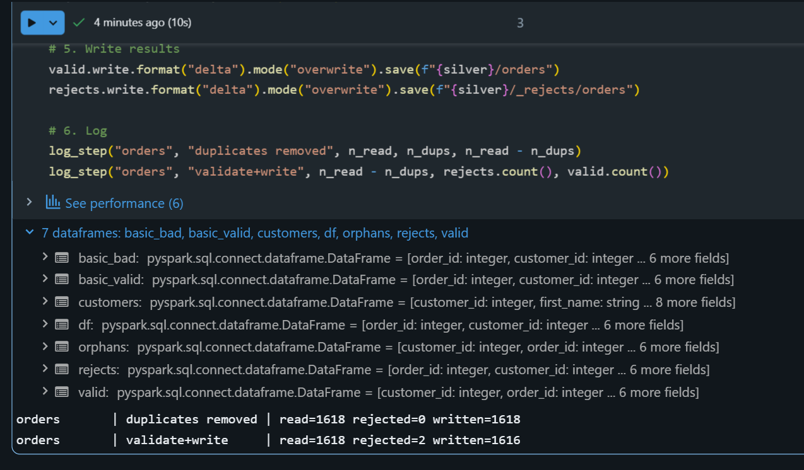</td>
    <td>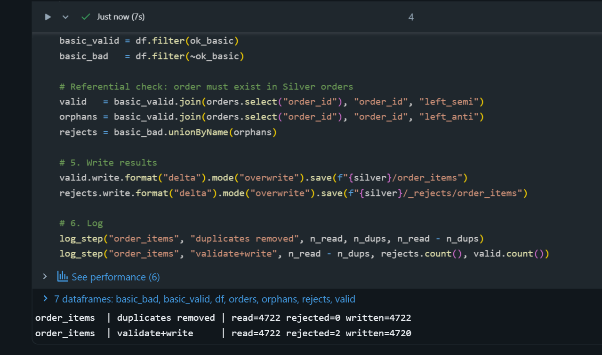</td>
  </tr>
  <tr>
    <td align="center">customers</td>
    <td align="center">orders</td>
    <td align="center">order_items</td>
  </tr>
</table>

---

## Pipeline Results

Gold pipeline log (`Gold/_pipeline_log`):

| Table | Step | Rows read | Rows rejected | Rows written |
|-------|------|----------:|--------------:|-------------:|
| sales_fact | join | 4,720 | 123 | 4,597 |
| daily_sales | aggregate | 4,597 | 0 | 711 |
| monthly_sales | aggregate | 4,597 | 0 | 29 |
| top_products | aggregate | 4,597 | 0 | 304 |
| customer_ltv | aggregate | 4,597 | 0 | 1,445 |
| revenue_by_store | aggregate | 4,597 | 0 | 3 |

> **Reading the `sales_fact` row:** the 123 "rejected" line items are not bad data. They belong to orders with status **Rejected (3)**, which are intentionally excluded from revenue.

After the `year` rebuild, the log shows `revenue_by_store` = 9, `top_products` = 432 and `customer_ltv` = 1,557 rows written (each read from the same 4,597 sales rows).

**End-to-end row flow for `order_items`:** `4,722` in source → `4,720` in Silver (2 quarantined) → `4,597` in the sales fact (123 belong to rejected orders).

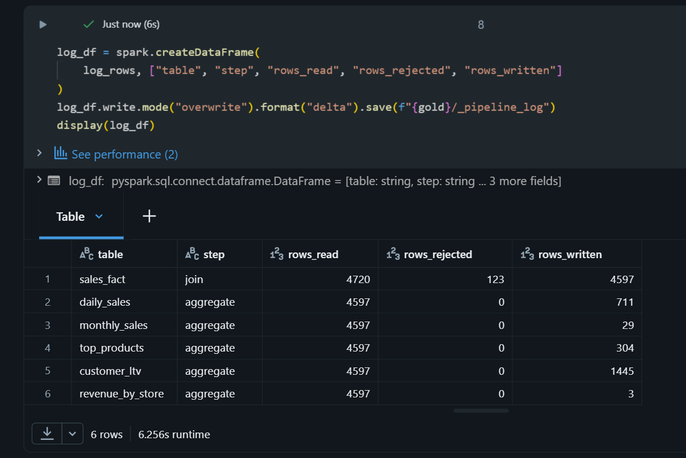

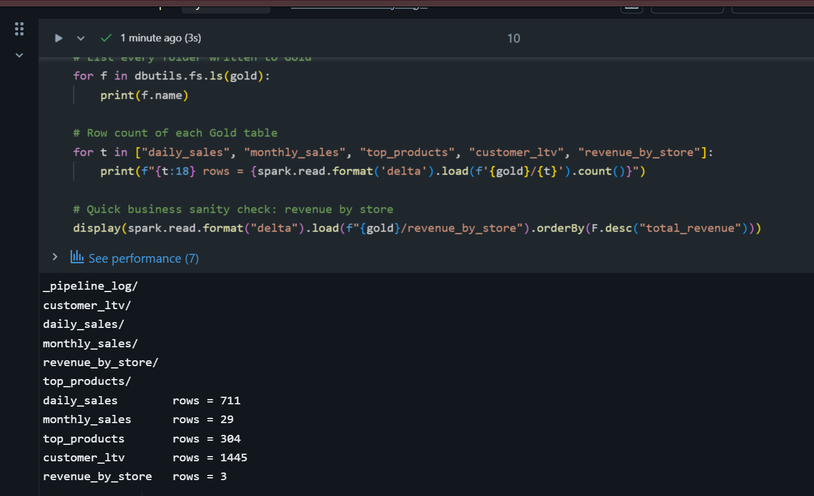

---

## Analytics Queries

Because the Gold tables are registered as `gold.*`, `02_silver_to_gold.ipynb` ends with SQL queries that answer business questions directly:

| Query | Question | Source table |
|-------|----------|--------------|
| Q2 | Top 10 products by revenue (all years combined) | `gold.top_products` |
| Q3 | Monthly revenue with month-over-month change and % growth (window `LAG`) | `gold.monthly_sales` |
| Q4 | Top 20 customers by lifetime value | `gold.customer_ltv` |
| Q5 | Customer value by state (customers, total LTV, LTV per customer) | `gold.customer_ltv` |
| Q6 | Revenue by category and year | `gold.top_products` |
| Extra | Date range covered, latest 40 days of sales, customer count check | `gold.daily_sales`, `gold.customer_ltv` |

---

## Dashboard

**BikeStores Sales Dashboard** (2016 to 2018), built in **Power BI** on the Gold layer, with a **Year** slicer. The report file is included in the repo: [`dashboard/bikestore_dashboard.pbix`](dashboard/bikestore_dashboard.pbix).

| KPI | Value |
|-----|------:|
| Total Revenue | ~7.43M |
| Total Orders | ~2K |
| Units Sold | ~7K |
| Average Order Value | ~4.73K |

Visuals:

- **Revenue by Store:** Baldwin Bikes leads clearly, followed by Santa Cruz Bikes and Rowlett Bikes.
- **Customer Value by State:** NY 68.46%, CA 21.01%, TX 10.52% of total lifetime value.
- **Top Products by Revenue:** led by Trek Slash 8 27.5 (2016), Trek Conduit+ (2016) and Trek Fuel EX 8 29 (2016).
- **Monthly Revenue Trend:** steady growth through 2016 to 2017 with a sharp rise at the end of the period.

Which Gold table feeds which visual (taken from the report file):

| Visual | Gold table | Fields |
|--------|-----------|--------|
| Year slicer | `monthly_sales` | `year` |
| KPI cards (Total Revenue, Total Orders, Units Sold, Avg Order Value) | `monthly_sales` | `total_revenue`, orders, units, AOV measures |
| Revenue by Store (bar) | `revenue_by_store` | `store_name`, `total_revenue` |
| Customer Value by State (donut) | `customer_ltv` | `state`, `lifetime_value` |
| Top Products by Revenue (bar) | `top_products` | `product_name`, `total_revenue` |
| Monthly Revenue Trend (area/line) | `monthly_sales` | `MonthStart`, `total_revenue` |

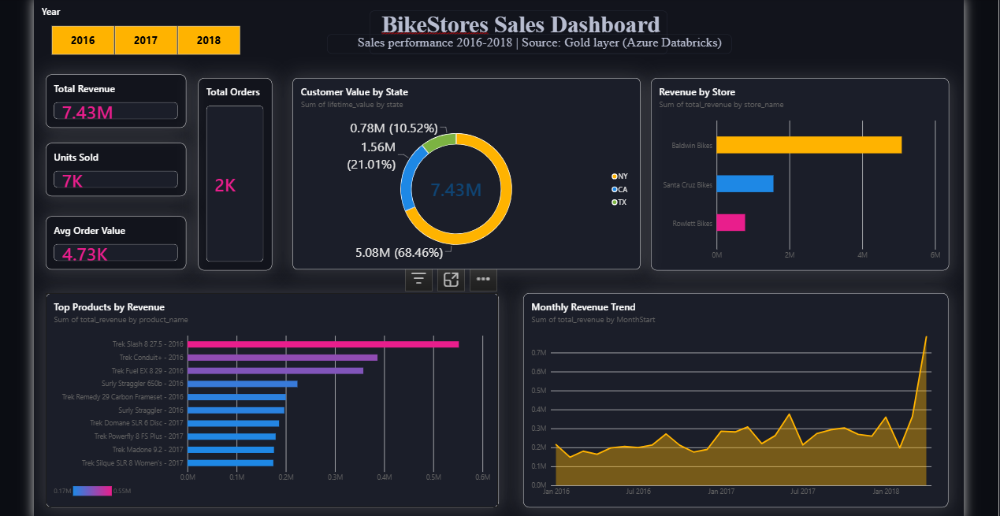

---

## Repository Structure

```
.
├── README.md
├── .gitignore
├── notebooks/
│   ├── 01_bronze_to_silver.ipynb     # Bronze (Parquet) -> Silver (Delta) + rejects + log
│   └── 02_silver_to_gold.ipynb       # Silver -> Gold aggregates + log + verification
├── dashboard/
│   └── bikestore_dashboard.pbix      # Power BI report
└── images/
    ├── architecture.png              # Architecture diagram
    └── 01 ... 11_*.png               # Screenshots of each pipeline stage
```

---

## How to Run

### Prerequisites

- An Azure subscription with a **Storage Account (ADLS Gen2)** and a container named `bikestores`
- An **Azure Data Factory** instance with linked services to SQL Server and the storage account
- An **Azure Databricks** workspace with a cluster or serverless compute
- Databricks has access to the storage account (access key, service principal or Unity Catalog external location)
- SQL Server with the BikeStores database

### Steps

1. **Load the source.** Restore or create the BikeStores database in SQL Server. Optionally insert dirty test rows (like order `1616` above).
2. **Land Bronze.** Use an **Azure Data Factory** pipeline to copy each source table from SQL Server into the container as Parquet, using this layout:
   ```
   bikestores/Bronze/sales/{customers, orders, order_items, stores}
   bikestores/Bronze/production/{products, categories, brands}
   ```
3. **Configure the path.** In both notebooks, set your storage account:
   ```python
   root = "abfss://bikestores@<your-storage-account>.dfs.core.windows.net"
   ```
4. **Run `01_bronze_to_silver.ipynb`** top to bottom. It produces the Silver tables, `_rejects/` and `_pipeline_log/`.
5. **Run `02_silver_to_gold.ipynb`** top to bottom. It produces the Gold tables and `_pipeline_log/`, and registers the `gold` database tables.
6. **Open the dashboard.** Open `dashboard/bikestore_dashboard.pbix` in Power BI Desktop. To refresh it with your own data, point the data source to your Gold tables.

> Both notebooks use `overwrite` mode, so they are safe to re-run.

---

## Design Decisions

| Decision | Reason |
|----------|--------|
| Quarantine bad rows in `_rejects/` instead of deleting them | Nothing is lost; data owners can review and fix problems at the source. |
| Validate in dependency order (customers, orders, order_items) | Enforces referential integrity inside the lake, which has no foreign keys. |
| Keep `shipped_date` as `NULL` for unshipped orders | A missing ship date is a valid business state, not a data error. |
| Exclude `order_status = 3` from revenue | Rejected orders never generated revenue. |
| Log counts at every step | Makes the pipeline auditable: any difference between layers can be explained. |
| Delta for Silver and Gold, Parquet for Bronze | Bronze stays a plain raw copy; Delta adds ACID writes and SQL access where consumers need it. |
| Dimension tables use one generic loop | Four small tables share identical logic (dedupe, trim, key check), so a config dictionary avoids repeated code. |

---

## Known Limitations and Future Improvements

- **Zero-price rule is permissive.** `list_price >= 0` lets a `0.00` price through (item 2 of order `1616` is verified to be in Silver). Tightening to `> 0` would catch it, unless free items are a real business case.
- **`year` added in a patch step.** The year column is added to three Gold tables in a final cell. Moving it into the main aggregation cells would make the notebook cleaner.
- **Full reload only.** Every run overwrites everything. Next step is incremental loading (watermark on `order_date`, or Delta `MERGE`).
- **No orchestration.** The notebooks are run manually. They could be chained after the Data Factory ingestion pipeline (Databricks notebook activities) or scheduled with Databricks Workflows.
- **`stocks` table not modelled.** Inventory analytics (stock by store and product) could be added as a new Gold table.
- **Automated tests.** Add assertions or expectations (for example, Delta Live Tables expectations) so a quality regression fails the pipeline.
- **Secrets handling.** Use Databricks secret scopes or Unity Catalog external locations instead of embedding storage details in notebooks.

---

## Author

**Wajeeha Badar**  
[GitHub](https://github.com/Wajeeha-Badar)

*Built as a hands-on Azure data engineering project: SQL Server → Azure Data Factory → ADLS Gen2 → Databricks → Dashboard.*
